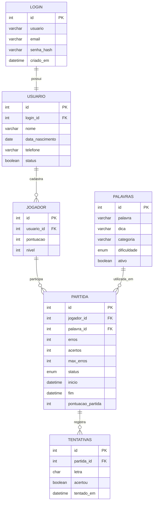

# Relacionamentos do banco de dados

## Cardinalidades
| Relação | Cardinalidade | Explicação |
|---|---|---|
| LOGIN → USUARIO | 1:1 | Cada usuário possui um login; cada login pertence a um usuário |
| USUARIO → JOGADOR | 1:N | Um usuário pode ter um ou mais perfis de jogador |
| JOGADOR → PARTIDA | 1:N | Um jogador pode jogar várias partidas |
| PALAVRAS → PARTIDA | 1:N | Uma palavra pode aparecer em várias partidas |
| PARTIDA → TENTATIVAS | 1:N | Uma partida pode registrar várias tentativas |

## Diagrama entidade-relacionamento

## Integridade referencial
- `USUARIO.login_id` referencia `LOGIN.id` e é UNIQUE para garantir a relação 1:1.
- `JOGADOR.usuario_id` referencia `USUARIO.id`.
- `PARTIDA.jogador_id` referencia `JOGADOR.id`.
- `PARTIDA.palavra_id` referencia `PALAVRAS.id`.
- `TENTATIVAS.partida_id` referencia `PARTIDA.id`.

O diagrama visual do projeto também está disponível no [DB Designer](https://dbdesigner.page.link/fDWH3oExuafwqt9q8).
